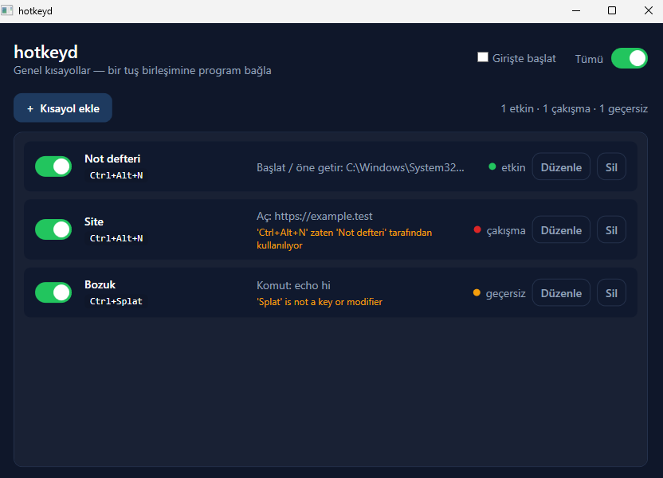

# hotkeyd

Bir tuş birleşimine bir program bağla. `Ctrl+Alt+N`'ye bas, Not Defteri açılsın;
zaten açıksa öne gelsin. Windows için, WPF ile, koyu ve sade bir arayüz.



Yukarıdaki görüntü programın gerçek bir çalışması: üç kısayol tanımlı, biri
işletim sistemine kaydedilmiş (**etkin**), biri aynı birleşimi istediği için
**çakışma**, biri de yazımı bozuk olduğu için **geçersiz**.

## Söz

Bir kısayol listede **etkin** görünüyorsa, işletim sistemi onu gerçekten kabul
etmiştir. Program "kaydettim" demez; `RegisterHotKey` çağrısının sonucuna bakar
ve sadece Windows evet dediğinde yeşil yakar. Başka bir program o birleşimi
kapmışsa, o satır kırmızı olur ve nedenini yazar — sessizce yarım çalışmaz.

Çakışma da **önceden** çözülür, işletim sistemine dokunmadan. İki açık kısayol
aynı birleşimi isterse, listede önce gelen onu tutar; geri kalanlar
**çakışma** olarak işaretlenir ve kaydedilmez. Hangi kısayolun sahibi olduğu
açıkça yazılır, böylece hatayı ararken tahmin etmezsin.

## Yalnızca bağladığın tuşları dinler

hotkeyd bir tuş kaydedici (keylogger) **değildir** ve öyle olamaz. İşletim
sisteminin kendi kısayol düzeneğini (`RegisterHotKey`) kullanır: Windows'a
hangi birleşimleri izleyeceğini söyler, Windows da yalnızca tam olarak o
birleşimlerden biri basıldığında tek bir mesaj yollar. Program klavyeye kanca
(hook) takmaz; bağlamadığın hiçbir tuşu görmez, hiçbir yere yazmaz.

Yönetici hakkı da istemez. Kısayollar sıradan bir kullanıcı işlemiyle
kaydedilir, girişte başlatma da yalnızca o kullanıcı için `HKCU\...\Run`
anahtarına yazılır.

## Ne yapar

- **Program başlat / öne getir** — yoksa başlatır, varsa penceresini öne alır.
- **Dosya veya bağlantı aç** — varsayılan uygulamayla açar.
- **Komut çalıştır** — bir komut satırı işletir.

Her kısayol tek tek açılıp kapanabilir; üstteki **Tümü** anahtarı hepsini bir
anda duraklatır (manuel aç/kapa). **Girişte başlat** işaretliyse bilgisayar
her açıldığında sessizce (`--tray`) devreye girer.

Tuş birleşimi kutuya yazılmaz; kutuya tıklayıp basılır, böylece saklanan şey
tam olarak bastığın şeydir.

## Nasıl çalıştırılır

```bash
dotnet run --project src/hotkeyd.App
```

Yayın sürümü (tek klasör):

```bash
dotnet publish src/hotkeyd.App -c Release
```

Ayarlar `%APPDATA%\hotkeyd\config.json` içinde tutulur. Dosya elle
düzenlenebilir; bozuk bir dosya sessizce silinmez, uyarılır — tam da
düzeltebilmen için program yine de açılır.

## Çekirdek neden ölçülebilir

Karar veren her şey — tuş çözümleme, çakışma bulma, hangi kısayolun
kaydedileceği — `hotkeyd.Core` içinde saftır: ne pencereye ne klavyeye ihtiyaç
duyar, aynı girdi hep aynı planı verir. Bu yüzden klavye olmadan baştan sona
test edilebilir.

```bash
dotnet test        # 22 test
```

- **Çözümleme** her kabul edilen tuş adını tek tek dener, her reddi adıyla
  ister (boş, tuşsuz, çift değiştirici, iki tuş, bilinmeyen sözcük).
- **Plan** ilk sahibin birleşimi tuttuğunu, kalanların çakıştığını, kapalı bir
  kısayolun birleşimi işgal etmediğini ve geçersiz bir satırın sonraki geçerli
  satırı engellemediğini doğrular.
- **Ayar deposu** her alanı yazıp geri okur ve bozuk dosyanın kayıtları yok
  etmeden hata verdiğini doğrular.

İşletim sistemine dokunan kısım (`RegisterHotKey`, pencere öne getirme) uygulama
katmanındadır; çekirdek bunu bilmez.

## Lisans

MIT.
